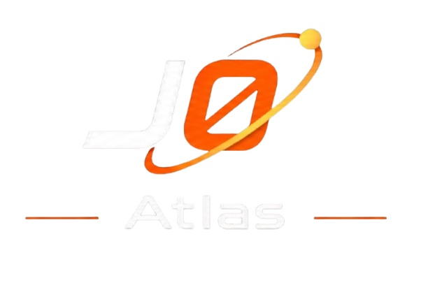

# J0-ATLAS — Autonomous Martian EVA Navigation & Rescue System

<p align="center">
  
</p>

**J0-ATLAS** is an interactive, zero-satellite planetary navigation and life-support decision system built for astronauts and surface vehicles operating in **Jezero Crater, Mars** (`18.485° N, 77.435° E`). Developed for the **NASA Space Apps Challenge (Valencia)**, the application combines real NASA orbital imagery, calibrated Perseverance MEDA atmospheric telemetry, and A* pathfinding to coordinate multi-crew Extravehicular Activities (EVAs) and compute optimal SOS evacuation routes in real time.

---

## Live Links & Demo

* **Live Interactive Web App:** `[LIVE_DEMO_URL — e.g., https://your-username.github.io/mars-nav/]`
* **Mission Trailer / Demo Video:** `[TRAILER_VIDEO_URL — YouTube / Vimeo link]`
* **Target Sector:** Jezero Crater Delta (`EPSG:4326` Martian Coordinate Reference System)

---

## The Problem

On Mars, there is no global GPS constellation, and Earth-to-Mars communication latency ranges from **4 to 24 minutes** each way. During dust storms, steep canyon crossings, or sudden suit oxygen/battery drops, astronauts cannot wait for ground control in Houston to recalculate safe routes. Crews need an autonomous, local-first navigation HUD capable of:
1. Triangulating position without orbiting satellites using surface beacons.
2. Dynamically rerouting around impassable geological hazards and localized dust storms.
3. Evaluating life-support thresholds and comparing the fastest survival routes when an SOS emergency occurs.

---

## Official NASA Data & Resources Integrated

J0-ATLAS is grounded in real mission datasets from **NASA Jet Propulsion Laboratory (JPL)** and the **Planetary Data System (PDS)**:

1. **NASA Mars Trek WMTS (MRO CTX Orthomosaic):**
   * Streams real 6-meter/pixel orbital imagery of Jezero Crater (`JEZ_ctx_B_soc_008_orthoMosaic_6m_Eqc_latTs0_lon0`), enhanced with switchable scientific visualization filters (**Optical**, **Topographic**, **Thermal THEMIS**, and **Geological USGS**).
2. **NASA PDS — Mars 2020 Perseverance MEDA (Calibrated Environmental Baseline):**
   * Uses real calibrated sensor metadata (`URN: urn:nasa:pds:mars2020_meda:data_calibrated_env`) from Mars Year 36 ($L_s = 6.15^\circ$) as the default local baseline:
     * **Air Temperature (`ATS`):** `-26.4 °C`
     * **Ground Thermal Infrared (`TIRS`):** `-11.2 °C`
     * **Atmospheric Pressure (`PS`):** `746.8 Pa` (vs. `750.0 Pa` base reference)
     * **Horizontal Wind Speed (`WS`):** `19.8 km/h` (`5.5 m/s`)
     * **Dust Optical Depth (`RDS`):** `τ = 0.38` | **Surface Radiation:** `0.64 mSv/day`
3. **NASA JPL Perseverance Raw Images API:**
   * Connects directly to the live JPL Mars 2020 downlink feed to display the latest Sol, rover `Site` / `Drive` sector, active camera instrument, and real surface POV imagery (with automatic fallback to calibrated local mode).

---

## Key Features & Engineering Architecture

### 1. Multi-Crew EVA Coordination (Up to 3 Simultaneous Routes)
* Supports independent mission profiles for **Route 1 (`EVA-01`)**, **Route 2 (`EVA-02`)**, and **Route 3 (`EVA-03`)** on the same map.
* Clicking any route or astronaut marker highlights that crew member and loads their individual telemetry sliders: **Route Completion (%)**, **Suit Oxygen (%)**, and **Battery / Power (%)**.
* Moving the completion slider smoothly interpolates the astronaut's exact geographic position along the computed path.

### 2. A* (A-Star) Pathfinding & Hazard Editor
* **90×90 Spatial Grid Solver with String-Pulling Smoothing:** Computes shortest ground trajectories while automatically curving around impassable canyon lines and storm circles.
* **Travel Mode Adaptation:** Evaluates success probability and travel speed across **Walking EVA (`3.5 km/h`)**, **Pressurized Rover (`15.0 km/h`)**, and **Aerial Drone (`35.0 km/h`)**, allowing drones to fly over ground canyons while still avoiding dust storms.
* **Interactive Hazard Editor:** Users can draw custom red canyon lines (with a visibility toggle to hide guide lines while keeping routing constraints active) and place adjustable-radius storm circles directly on the map.

### 3. Physical Dust Storm & Risk Model
J0-ATLAS computes local storm probability ($P_{\text{storm}}$) from the MEDA baseline using convective thermal contrast ($\Delta T = T_{\text{ground}} - T_{\text{air}}$), pressure drop ($\Delta P$), and aeolian wind drag:

$$I_{\text{conv}} = \min\left(1,\; 0.6 \cdot \frac{\max(0,\; T_{\text{ground}} - T_{\text{air}})}{35} + 0.4 \cdot \frac{\max(0,\; 750 - P)}{30}\right)$$

$$I_{\text{aeolian}} = \min\left(1,\; \left(\frac{v}{70}\right)^{1.5} \cdot \left(0.5 + 0.5 \cdot \min(\tau,\; 1.5)\right)\right)$$

$$P_{\text{storm}}\;(\%) = \min\left(99,\; \text{round}\Big(100 \cdot \big(0.55 \cdot I_{\text{aeolian}} + 0.30 \cdot I_{\text{conv}} + 0.15 \cdot \min(\tau / 2.0,\; 1)\big)\Big)\right)$$

### 4. Automated SOS Alerts & Top-2 Nearest Shelters Comparison
* **Shelter Deployment (`BASE` + `R2`, `R3`...):** The first habitat placed on the map is automatically designated as **`BASE`**, followed by numbered auxiliary shelters.
* **Critical Threshold Detection:** If an astronaut's **Oxygen** or **Battery** drops below **`30%`**, their marker pulses red and triggers an evacuation alert. If **Global Storm Risk** reaches **`≥ 65%`**, all active EVA routes switch to emergency evacuation mode simultaneously.
* **Top-2 Escape Optimization:** From each astronaut's exact current coordinate along their route, J0-ATLAS computes canyon-free paths to all shelters, filters strictly the **2 nearest options**, and displays a comparative breakdown showing how many **minutes**, **% of oxygen**, and **extra % probability of success** the optimal route saves over the second alternative.

### 5. AR Helmet Visor HUD & Local Beacon Triangulation
* **No-Satellite Triangulation:** Continuously locks onto the 2 nearest surface safe beacons (`S1`–`S6`) during animated GPS navigation.
* **AR Helmet HUD Mode:** Toggles a full-screen augmented reality visor overlay displaying real-time suit vitals, radiation dosage, and tactical escape orders.

---

## How to Run Locally

No build tools, package managers, or backend servers are required:

1. Clone or download this repository:
   ```bash
   git clone [https://github.com/](https://github.com/)[YOUR_USERNAME]/[YOUR_REPO_NAME].git
